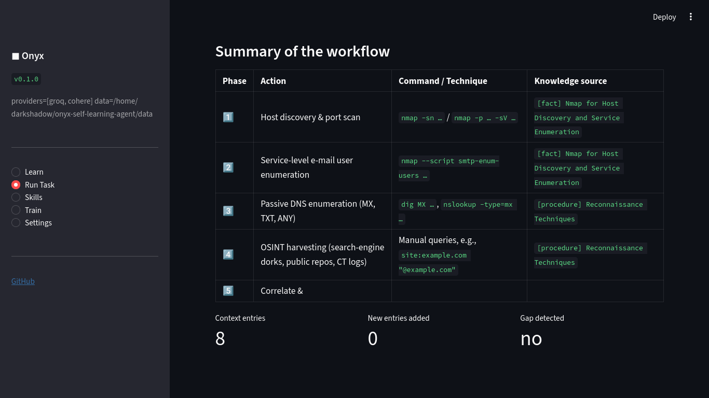
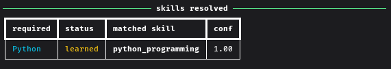

# Onyx — Self-Learning AI Agent

```markdown

> An autonomous agent that researches the web to build its own skill knowledge bases, then executes multi-skill tasks end-to-end.

📖 **Read the story behind Onyx:**
- [LinkedIn Article](https://www.linkedin.com/pulse/i-built-self-learning-ai-agent-from-scratch-heres-what-mubbshra-iqbal-xl6he)
- [Medium Article](https://medium.com/@mubashraiqbal.pk/i-built-a-self-learning-ai-agent-from-scratch-heres-what-i-learned-672d59621459)

[](https://www.python.org/downloads/)
[](https://opensource.org/licenses/MIT)
[](https://github.com/astral-sh/ruff)
[](https://mypy-lang.org/)

Onyx is a self-learning agent that acquires skills on demand. Give it a task — it analyzes what skills are needed, checks its existing knowledge base, learns any missing skills from the web, and combines everything to complete the task with working code.

No manual skill configuration. No pre-loaded knowledge. Just a task.

---
## 📸 Screenshots

| Web Dashboard | Terminal Execution |
| :---: | :---: |
|  |  |
## Table of Contents

- [What It Does](#what-it-does)
- [Key Features](#key-features)
- [Benchmark Results](#benchmark-results)
- [Demo](#demo)
- [Quick Start](#quick-start)
- [Usage](#usage)
- [Architecture](#architecture)
- [API Reference](#api-reference)
- [Configuration](#configuration)
- [Project Structure](#project-structure)
- [Development](#development)
- [Roadmap](#roadmap)
- [Contributing](#contributing)
- [License](#license)

---

## What It Does

Onyx operates in four modes:

### 1. Task-Driven (Autonomous)

```bash
onyx task "Write a Python script that reads a JSON file and pretty-prints it with sorted keys"
```

The agent will:

1. **Analyze** the task → identifies required skills (Python, JSON, File I/O)
2. **Match** against existing skills in the registry
3. **Learn** any missing skills from the web automatically
4. **Retrieve** relevant knowledge from all matched skills
5. **Execute** the task (with sandboxed code when needed)
6. **Compose** the final answer, citing each skill used

### 2. Skill-Scoped (Explicit)

```bash
onyx learn "Python asyncio"
onyx run python_asyncio "Write a basic asyncio example that runs 3 tasks concurrently"
```

### 3. Model Training

```bash
onyx train "Train a logistic regression classifier on the iris dataset and report accuracy"
```

The agent plans a training pipeline, downloads a public dataset, generates self-contained training code, executes it in a sandbox, and reports the final metric.

### 4. Bounded Memory with User-Guided Eviction

Unlike most self-learning agents, Onyx caps total skills at a configurable limit (default: 20). When the cap is reached, the user chooses which skill to forget — informed by real usage statistics.

```bash
onyx stats                # Show capacity + per-skill usage
onyx learn "new_skill"    # Prompts for eviction if memory is full
onyx learn --auto-evict   # Automatically evicts least-used skill
onyx learn --no-evict     # Refuses to evict; raises an error instead
```

---
### 📊 Benchmark: Context Bloat vs. User-Guided Eviction

To prove the necessity of bounded memory, we evaluated the vector database retrieval system. We simulated an "Unbounded Memory" agent (containing irrelevant skills like `cooking_pasta` and `quantum_physics`) versus a "Curated Memory" agent (User-Guided Eviction applied).

When asked: *"How do I create a simple route in a Flask app?"*

| Configuration | Skills in DB | Retrieval Source | Context Retrieved |
| :--- | :---: | :--- | :---: |
| **Unbounded (No Eviction)** | 4 | `cooking_pasta`, `quantum_physics`, `rust_macros`, `python_flask` | 4 chunks (3 irrelevant, 1 relevant) |
| **Curated (User-Guided)** | 1 | `python_flask` | 1 chunk (1 relevant) |

**Conclusion:** Unbounded memory retrieval injects irrelevant context into the LLM's prompt, causing "context bloat." **User-Guided Eviction** acts as a semantic filter, drastically reducing context bloat and guaranteeing high-fidelity reasoning.
## Key Features

### Bounded memory with four eviction policies

Most skill-learning agents (Voyager, Reflexion, ExpeL) accumulate skills indefinitely. This causes context bloat, vector DB degradation, and cost explosion. Onyx tracks `usage_count` and `last_used` per skill and offers four eviction policies:

| Policy | Behavior |
|---|---|
| `cold` | No memory — baseline for ablation |
| `fifo` | Evict the oldest skill |
| `lru` | Evict the least-recently-used skill |
| `user` | Interactive prompt — user chooses based on usage stats |

### Multi-provider LLM failover

Free-tier LLM providers enforce strict rate limits. Onyx maintains a provider pool that automatically fails over on `429` errors, spreading load across:

- **Groq** (primary — `openai/gpt-oss-120b`)
- **Cohere** (`command-r-plus-08-2024`)
- **Mistral** (`mistral-small-latest`)
- **Gemini** (`gemini-flash-latest`)

Round-robin scheduling with retry logic keeps long-running benchmarks alive even under aggressive throttling.

### Keyless multi-engine search

Onyx's search layer uses four free engines with automatic failover — **no API keys required**:

1. **webless** — fuses DuckDuckGo + Mojeek + Bing + Wikipedia via Reciprocal Rank Fusion
2. **ddgs** — DuckDuckGo with retry
3. **SearXNG HTML** — scrapes a public instance
4. **Jina Reader** — keyless search endpoint

Every result passes through a relevance filter so junk domains (FedEx, Pinterest, YouTube) never reach the crawler.

### Rate-limit-aware benchmarking

Standard wall-clock measurement penalizes agents for infrastructure limits rather than their own behavior. Onyx reports two numbers:

- **`total_seconds`** — full wall clock
- **`work_seconds`** — total minus provider wait time

Paper claims are made on `work_seconds`, isolating the agent's real compute cost.

### Autonomous model training across three frameworks

The training module accepts a natural-language task and outputs a working model. It selects the appropriate library, generates self-contained code, runs it in a resource-limited sandbox, and parses the final metric from stdout.

---

## Benchmark Results

### Training Module — 7/7 tasks across three frameworks

| Task | Framework | Metric | Time |
|---|---|---|---|
| iris classification | scikit-learn | accuracy = 0.93 | 4.5s |
| digits classification | scikit-learn | accuracy = 0.86 | 9.8s |
| wine classification | scikit-learn | accuracy = 1.00 | 4.0s |
| breast cancer classification | scikit-learn | accuracy = 0.96 | 9.4s |
| digits CNN | PyTorch | accuracy = 0.79 | 11.2s |
| california housing MLP | PyTorch | RMSE = 2.21 | 20.7s |
| IMDB sentiment | transformers | accuracy = 0.91 | 24.6s |

**Success rate: 7/7 (100%).** Full artifacts in [`demo/`](demo/).

The framework selection is autonomous — the LLM reads the task, chooses the appropriate library, and generates code without any template scaffolding.

### Skill-Learning Benchmark — in progress

Comparing cold start (no memory) versus warm start (memory reuse) across ten tasks under each eviction policy. Records `work_seconds` (excluding rate-limit waits) rather than wall clock. Results will be added to `demo/` as they complete.

---

## Demo

Real output from a running Onyx instance is available in the [`demo/`](demo/) folder. Every JSON file there is auto-generated by the agent — nothing is hand-written.

**Skills learned in the latest run:**

| Skill | Entries | Task Executed |
|---|---|---|
| `open_source_intelligence_osint` | 20 | OSINT tool categories for email discovery |
| `linux_command_line` | 12 | Bash one-liner for largest files |
| `python_decorators` | 11 | Decorator that logs function calls |
| `python_asyncio` | 10 | Concurrent task execution |
| `dockerfile_for_python_flask` | 8 | Minimal Dockerfile for a Flask app |
| `json` | 10 | JSON parsing and formatting |
| `file_i_o` | 18 | File reading and validation |

**Sample from a real run:**

```
$ onyx task "Write a Python script that reads a JSON file and pretty-prints it with sorted keys"

Analyzing task...
  Required skills: Python, JSON, File I/O
  Matching: Python
    ✅ Matched -> python_decorators (conf 0.90)
  Matching: JSON
    📚 Learning new skill: JSON
    ✅ Learned -> json (10 entries)
  Matching: File I/O
    📚 Learning new skill: File I/O
    ✅ Learned -> file_i_o (18 entries)
Retrieving combined knowledge...
Executing via primary skill: python_decorators
  Generating code...
  Running code in sandbox...
Composing final answer...
Done in 85.2s

[final answer with working script, citations to each skill, and sandbox output]
```

---

## Quick Start

### Option A: Google Colab (Free, No Setup)

Run this in a Colab cell:

```python
!git clone https://github.com/VulnSeeker/onyx-self-learning-agent.git
%cd onyx-self-learning-agent

!pip install -e ".[api]" -q

# Set your API key
import os
os.environ["GROQ_API_KEY"] = "gsk-your-key-here"
os.environ["DATA_DIR"] = "/content/onyx-data"

# Run a task
!onyx task "Write a Python function that sorts a list of dictionaries by a given key"
```

### Option B: Local Install

```bash
# Clone
git clone https://github.com/VulnSeeker/onyx-self-learning-agent.git
cd onyx-self-learning-agent

# Install
pip install -e ".[api,dev]"

# Configure
cp .env.example .env
# Edit .env and add your API key

# Verify
onyx info
```

### Option C: Docker

```bash
# Build
docker build -t onyx:latest .

# Run
docker run --rm -p 8000:8000 --env-file .env onyx:latest

# Test
curl http://localhost:8000/health
```

---

## Usage

### CLI Commands

| Command | Description |
|---|---|
| `onyx task "<task>"` | Execute a task end-to-end (auto-learn + multi-skill) |
| `onyx learn <skill>` | Bootstrap a specific skill from web research |
| `onyx run <skill> <task>` | Execute a task using a specific skill |
| `onyx train "<task>"` | Plan and train a small ML model |
| `onyx skills` | List all learned skills with usage stats |
| `onyx stats` | Show memory capacity and per-skill usage |
| `onyx show <skill>` | Show details and knowledge entries for a skill |
| `onyx delete <skill>` | Delete a skill and its knowledge base |
| `onyx serve` | Launch the FastAPI service |
| `onyx web` | Launch the Streamlit dashboard |
| `onyx info` | Show current configuration |
| `onyx version` | Show version |

### Python Library

```python
from onyx import Onyx

agent = Onyx()

# Task-driven (autonomous)
result = agent.task(
    "Write a Python script that fetches a URL and extracts all links"
)
print(result.answer)

# Skill-scoped (explicit)
agent.learn("Python asyncio")
result = agent.run("python_asyncio", "Write a rate-limited HTTP client")
print(result.answer)

# Autonomous model training
plan = agent.train_model("Train a decision tree on sklearn's wine dataset")
print(plan["metric"])

# Inspect memory
print(agent.capacity())        # {'used': 8, 'cap': 20, 'free': 12}
print(agent.memory_stats())    # per-skill usage details

# Access the knowledge base
for skill in agent.skills():
    print(f"{skill.skill_id}: {skill.entry_count} entries")
```

### REST API

Start the service:

```bash
onyx serve --host 0.0.0.0 --port 8000
```

Then:

```bash
# Submit a task (returns job ID)
curl -X POST http://localhost:8000/task \
  -H "Content-Type: application/json" \
  -d '{"task": "Write a bash one-liner to count unique lines"}'

# Poll for result
curl http://localhost:8000/task/<job_id>

# List skills
curl http://localhost:8000/skills

# Health check
curl http://localhost:8000/health
```

Interactive API docs available at `http://localhost:8000/docs`.

---

## Architecture

Onyx is organized as a layered system:

```
┌──────────────────────────────────────────────────────┐
│                    INTERFACES                        │
│  CLI (argparse)  │  REST API (FastAPI)  │  Web (Streamlit)  │
└───────────────────────┬──────────────────────────────┘
                        │
┌───────────────────────▼──────────────────────────────┐
│              TASK ORCHESTRATOR                       │
│  analyze → match skills → auto-learn → execute       │
│  → combine knowledge → compose answer                │
└───────────────────────┬──────────────────────────────┘
                        │
        ┌───────────────┼───────────────┐
        ▼               ▼               ▼
┌───────────────┐ ┌──────────────┐ ┌──────────────┐
│  BOOTSTRAPPER │ │   RUNTIME    │ │ MODEL BUILDER│
│  (learn new   │ │ (execute     │ │ (train small │
│   skills)     │ │  tasks)      │ │  ML models)  │
└───────┬───────┘ └──────┬───────┘ └──────┬───────┘
        │                │                │
        ▼                ▼                ▼
┌──────────────────────────────────────────────────────┐
│                  I/O LAYER                           │
│  LLM pool │ Web search │ Crawler │ Sandbox           │
└───────────────────────┬──────────────────────────────┘
                        │
┌───────────────────────▼──────────────────────────────┐
│              STORAGE + MEMORY                        │
│  Registry │ VectorStore │ MemoryManager (bounded)    │
└──────────────────────────────────────────────────────┘
```

### Core Modules

| Module | Responsibility |
|---|---|
| `agent.py` | Top-level `Onyx` facade |
| `orchestrator.py` | Task → skills → execution pipeline |
| `bootstrapper.py` | Web research → knowledge base |
| `runtime.py` | Skill-scoped task execution |
| `memory.py` | Bounded memory manager with 4 eviction policies |
| `model_builder.py` | Small ML model planning + training |
| `llm.py` | Multi-provider OpenAI-compatible client with failover |
| `search.py` | 4-engine web search (webless, ddgs, SearXNG, Jina) |
| `crawler.py` | robots.txt-aware HTML crawler |
| `sandbox.py` | Resource-limited sandboxed Python execution |
| `scoring.py` | LLM-as-judge answer quality scoring (0–3 rubric) |
| `storage.py` | SQLite registry + ChromaDB vector store |
| `api.py` | FastAPI service |
| `cli.py` | Command-line interface |
| `web.py` | Streamlit dashboard |

### How Self-Learning Works

1. **Spec generation**: LLM generates a structured skill spec (subtopics, tools, keywords)
2. **Source discovery**: Web search finds 3–12 high-quality sources via 4-engine fallback
3. **Extraction**: LLM extracts structured knowledge entries (facts, procedures, code, tools)
4. **Deduplication**: Two-tier dedupe (embedding distance + LLM verdict) avoids duplicates
5. **Storage**: Entries stored in per-skill ChromaDB collections
6. **Retrieval**: At runtime, relevant entries retrieved via semantic search
7. **Gap detection**: Runtime detects missing knowledge and updates the skill DB

### How Bounded Memory Works

1. **Usage tracking**: Every skill retrieval increments `usage_count` and refreshes `last_used`
2. **Capacity check**: Before adding a new skill, the bootstrapper checks against `MAX_SKILLS`
3. **Policy selection**: If full, the configured eviction policy selects a skill to remove
4. **Eviction**: Both the SQLite record and the ChromaDB collection are deleted

---

## API Reference

### `POST /task`

Submit a task for asynchronous execution.

**Request:**
```json
{
  "task": "Write a Python script that parses a CSV file",
  "auto_learn": true
}
```

**Response (202 Accepted):**
```json
{
  "job_id": "abc123def456",
  "status": "queued",
  "poll_url": "http://localhost:8000/task/abc123def456"
}
```

### `GET /task/{job_id}`

Poll for task status and result.

**Response:**
```json
{
  "job_id": "abc123def456",
  "task": "Write a Python script...",
  "status": "done",
  "elapsed_seconds": 42.3,
  "result": {
    "answer": "...",
    "code_output": "...",
    "skill_matches": [...]
  }
}
```

### `GET /skills`

List all learned skills.

### `GET /skills/{skill_id}`

Get details and knowledge entries for a specific skill.

### `DELETE /skills/{skill_id}`

Delete a skill and its knowledge base.

### `GET /health`

Liveness and readiness probe.

---

## Configuration

All configuration is via environment variables (see `.env.example`).

### Required

At least one LLM provider key:

| Variable | Description |
|---|---|
| `GROQ_API_KEY` | Groq API key (free tier available) |
| `COHERE_API_KEY` | Cohere API key (free tier available) |
| `MISTRAL_API_KEY` | Mistral API key (free tier available) |
| `GEMINI_API_KEY` | Google Gemini API key (free tier available) |

Onyx works with **free-tier accounts only** — no credit card required for any provider.

### LLM Provider Pool

Providers are tried in priority order; on `429` (rate limit) or connection error, the next provider takes over.

| Variable | Default | Description |
|---|---|---|
| `LLM_MODEL` | `openai/gpt-oss-120b` | Model used with each provider |
| `EMBED_MODEL` | `text-embedding-3-small` | Embedding model |

### Storage

| Variable | Default | Description |
|---|---|---|
| `DATA_DIR` | `./data` | Where runtime data is stored |
| `LOG_LEVEL` | `INFO` | Logging verbosity |

### Memory

| Variable | Default | Description |
|---|---|---|
| `MAX_SKILLS` | `20` | Maximum number of skills before eviction triggers |

### Behaviour Tuning

| Variable | Default | Description |
|---|---|---|
| `MAX_SOURCES_PER_SKILL` | `12` | Web sources per skill bootstrap |
| `MAX_PAGES_PER_SOURCE` | `1` | Pages fetched per source |
| `REQUEST_TIMEOUT` | `20` | HTTP timeout in seconds |
| `CODE_TIMEOUT` | `20` | Sandbox execution timeout |
| `DEDUPE_DISTANCE` | `0.12` | Cosine distance threshold for dedupe |
| `MAX_CHARS_PER_PAGE` | `12000` | Max characters extracted per page |
| `EXTRACT_DELAY_SECONDS` | `4` | Pacing between extraction calls (rate-limit friendly) |

### API Service

| Variable | Default | Description |
|---|---|---|
| `ONYX_API_TOKEN` | (empty) | Bearer token; auth disabled if empty |
| `ONYX_CORS_ORIGINS` | `*` | Comma-separated allowed origins |
| `ONYX_JOB_TTL_SECONDS` | `3600` | Job retention window |

---

## Project Structure

```
onyx-self-learning-agent/
├── .github/workflows/         # CI + Docker workflows
├── demo/                      # Real auto-generated JSON exports
├── src/onyx/                  # Main package
│   ├── __init__.py
│   ├── agent.py               # Onyx facade
│   ├── orchestrator.py        # Task orchestration
│   ├── bootstrapper.py        # Skill learning
│   ├── runtime.py             # Task execution
│   ├── memory.py              # Bounded memory manager
│   ├── model_builder.py       # ML training
│   ├── llm.py                 # Multi-provider LLM client
│   ├── search.py              # 4-engine web search
│   ├── crawler.py             # HTML crawler
│   ├── sandbox.py             # Code sandbox
│   ├── scoring.py             # LLM-as-judge
│   ├── storage.py             # SQLite + Chroma
│   ├── schemas.py             # Pydantic models
│   ├── config.py              # Configuration
│   ├── api.py                 # FastAPI service
│   ├── cli.py                 # CLI entry point
│   └── web.py                 # Streamlit dashboard
├── tests/                     # Pytest suite
├── benchmark.py               # Benchmark harness
├── Dockerfile                 # Production container
├── docker-compose.yml         # Local dev stack
├── pyproject.toml             # Package + tooling config
├── requirements.txt           # Runtime deps
├── requirements-dev.txt       # Dev deps
├── .env.example               # Environment template
└── README.md
```

---

## Development

### Setup

```bash
# Clone
git clone https://github.com/VulnSeeker/onyx-self-learning-agent.git
cd onyx-self-learning-agent

# Install dev dependencies
pip install -e ".[api,dev]"

# Copy env template
cp .env.example .env
# Edit .env with your API key
```

### Running Tests

```bash
# Run all tests
pytest

# With coverage report
pytest --cov=onyx --cov-report=term-missing

# Just unit tests
pytest -m unit
```

### Linting

```bash
# Check for issues
ruff check src tests

# Auto-fix where possible
ruff check --fix src tests

# Check formatting
ruff format --check src tests
```

### Type Checking

```bash
mypy src
```

### Pre-commit Hooks

```bash
pre-commit install
```

---

## Roadmap

- [x] Web research → knowledge base pipeline
- [x] Sandboxed code execution
- [x] Multi-skill task orchestration
- [x] FastAPI REST service
- [x] Docker + docker-compose
- [x] Bounded memory with usage tracking
- [x] Four eviction policies (cold, FIFO, LRU, user-guided)
- [x] Multi-provider LLM failover
- [x] Keyless multi-engine search (webless, ddgs, SearXNG, Jina)
- [x] Autonomous ML training (7/7 across sklearn, PyTorch, transformers)
- [x] LLM-as-judge scoring (0–3 rubric)
- [ ] Full cold/warm benchmark results
- [ ] Hard synthesis task suite (h1–h5)
- [ ] Statistical analysis (McNemar's test, bootstrap CIs)
- [ ] Render / Fly.io deployment
- [ ] Approval queue for knowledge updates
- [ ] Graph memory for entity relations
- [ ] Multi-agent collaboration

---

## Contributing

Contributions welcome. To get started:

1. Fork the repository
2. Create a feature branch (`git checkout -b feature/amazing-feature`)
3. Make your changes
4. Run `ruff check src tests` and `pytest` to verify
5. Commit (`git commit -m 'feat: add amazing feature'`)
6. Push (`git push origin feature/amazing-feature`)
7. Open a pull request

Please open an issue before submitting a pull request for substantial changes.

---

## Requirements

- Python 3.10, 3.11, or 3.12
- At least one LLM provider API key (free tiers available)
- (Optional) Docker for containerized deployment

---

## License

MIT License — see [LICENSE](LICENSE) for details.

---

## Author

**Mubbshra Iqbal** — BS Information Technology, Lahore College of Arts, Science and Technology (GCUF-affiliated)

- GitHub: [@VulnSeeker](https://github.com/VulnSeeker)
- Repository: [onyx-self-learning-agent](https://github.com/VulnSeeker/onyx-self-learning-agent)

---

_If you find this project useful, consider starring the repository._
